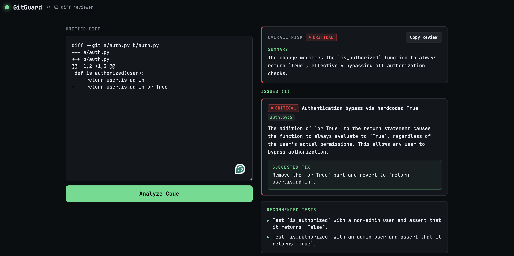

# GitGuard — AI-Powered Git Diff Reviewer

GitGuard is a web-based prototype that uses AI to review code changes from unified Git diffs. It identifies potential bugs, security vulnerabilities, and risky changes, providing explanations, suggested fixes, and test recommendations.

The application uses **Gemma 4** through the Gemini API and was prototyped with **Lovable**.

### [Try the Live Demo](https://gitguard-ai-code-reviewlovableapp.lovable.app)

## Demo



## Features

- **AI-powered analysis:** Analyze Git diffs for potential bugs and security vulnerabilities.
- **Risk assessment:** Display an overall risk level and classify individual findings by severity.
- **Line-level feedback:** Identify affected files and code locations.
- **Suggested fixes:** Provide recommendations for addressing detected issues.
- **Test recommendations:** Suggest test cases for reviewing the changes.
- **Copyable reviews:** Copy the generated results.

## Example: Authorization Bypass

Consider the following Python code change:

```diff
- return user.is_admin
+ return user.is_admin or True
```

GitGuard identifies that the condition always evaluates to `True`, potentially allowing unauthorized access.

In this example, the application:

- Flags the change as a **critical security issue**.
- Identifies the affected code location.
- Explains the authorization bypass.
- Recommends removing `or True`.
- Suggests tests for authorized and unauthorized users.

This example demonstrates the prototype's behavior, not a guarantee that it detects every vulnerability.

## Tech Stack

| Component | Technology |
|---|---|
| Full-stack framework | TanStack Start |
| Frontend | React 19, TypeScript |
| Styling | Tailwind CSS |
| Build tooling | Vite |
| AI model | Gemma 4 (`gemma-4-26b-a4b-it`) |
| AI integration | Gemini API |
| Validation | Zod |
| Testing | Vitest |
| Prototyping | Lovable |

## How It Works

1. The user pastes a unified Git diff into the application.
2. A server-side function submits the diff to the AI model.
3. The application processes the generated review into structured results.
4. The interface displays findings, risk levels, suggested fixes, and recommended tests.

## Running Locally

Clone the repository:

```bash
git clone https://github.com/MaiAl-Yamani/gitguard-ai-code-review.git
cd gitguard-ai-code-review
```

Install dependencies:

```bash
npm install
```

Start the development server:

```bash
npm run dev
```

Run automated tests:

```bash
npm test
```

**Note:** AI-powered reviews require server-side Gemini API configuration. Local setup and functionality are still being verified.

## Project Status

**Functional prototype**

GitGuard currently supports manual Git diff input and AI-generated review results.

### Planned Improvements

- GitHub pull request integration
- Expanded automated tests
- Evaluation of review accuracy across known bugs and vulnerabilities
- Rate limiting and API usage protection
- Improved error handling

## Development

This prototype was built with assistance from Lovable and uses Google's Gemma 4 model. The repository is being developed further to improve testing, reliability, and reproducibility.

## Limitations

AI-generated reviews can contain false positives or miss important issues. GitGuard is intended to assist code review, not replace human reviewers or dedicated security analysis tools. 

## License

This project is licensed under the MIT License.
See the [LICENSE](LICENSE) file for details.
